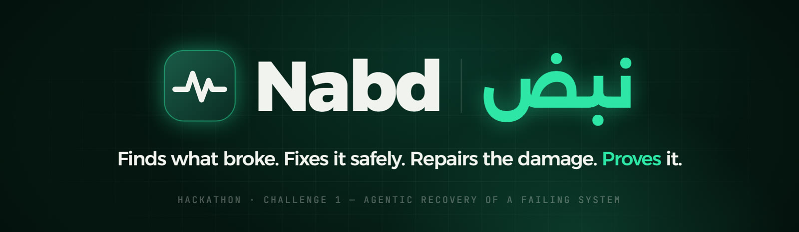
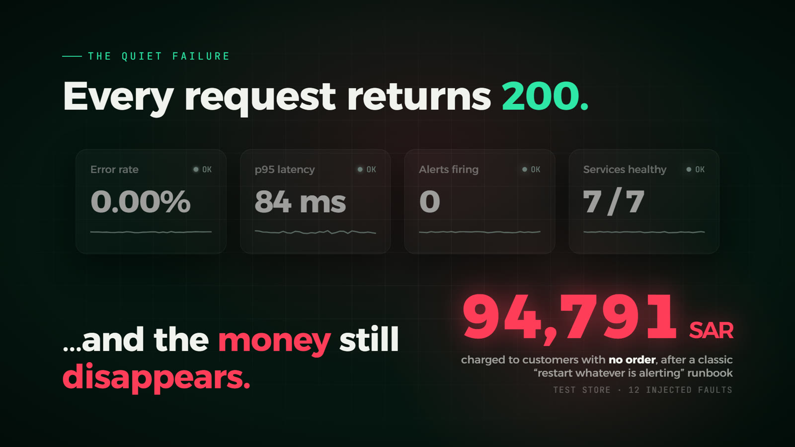
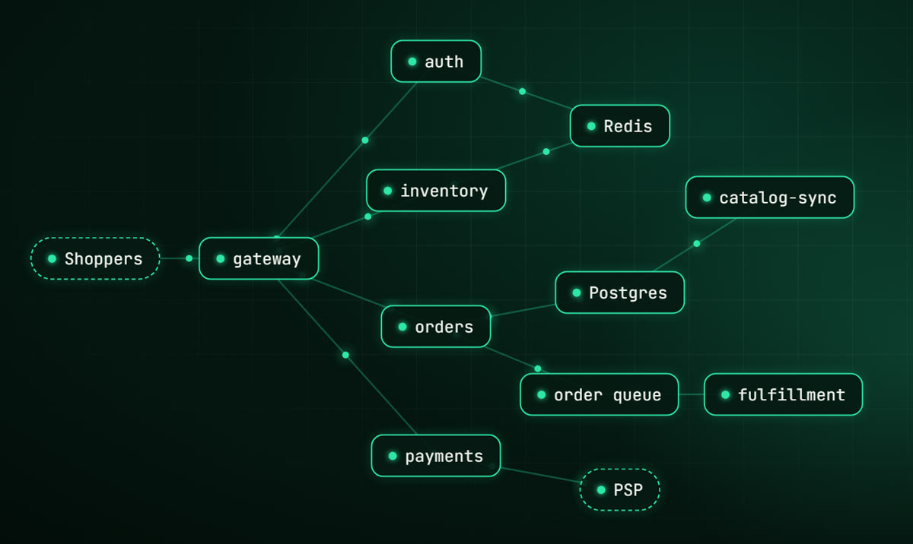
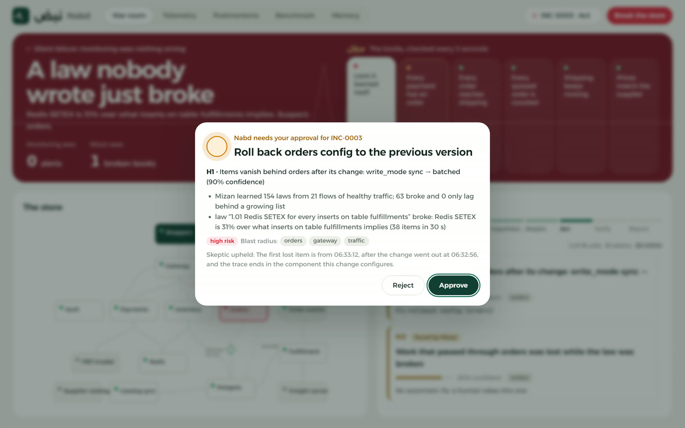
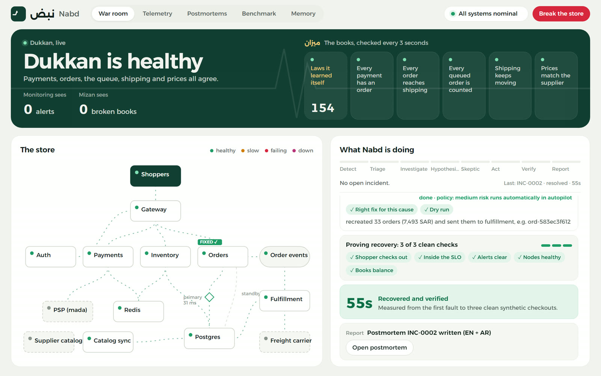
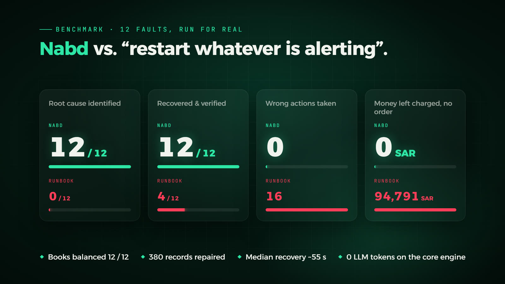

<p align="center">
  
</p>

<p align="center">
  An autonomous SRE agent that keeps a live online store running, including through failures that never raise an alert.<br>
  Hackathon Challenge 1: <i>Agentic Recovery of a Failing System</i>
</p>

<p align="center">
  <a href="#run-it">Run it</a> ·
  <a href="#try-it">Try it</a> ·
  <a href="#results">Results</a> ·
  <a href="docs/mizan.md">Mizan</a> ·
  <a href="docs/decisions.md">How it decides</a> ·
  <a href="docs/evaluation.md">Evaluation</a>
</p>

## The problem

<p align="center"></p>

Monitoring asks each service whether it is healthy. In a silent failure every service says yes. Requests return 200 and no alert fires, while customers are charged for orders that were never saved. A restart does not help when the cause is a bad deploy, because the service reads the same bad setting again.

## What Nabd does

Nabd watches Dukkan, a small Saudi online store that runs in Docker with simulated shoppers. It has seven services, a catalog-sync job, an order queue, Postgres, Redis, and stubs for the payment provider (PSP), a freight carrier and a supplier.

<p align="center"></p>

When something breaks, Nabd runs the loop an on-call engineer would, and goes back to investigating if verification fails:

```
Detect → Triage → Investigate → Hypothesize → Skeptic → Act → Verify → Report
```

| Part | What it does |
|---|---|
| Mizan, the books | Every 3 seconds it checks records that no single service controls. Each payment at the PSP needs an order for the same amount, each order needs a shipment, each queue message must be accounted for, and prices must match the supplier. This is how Nabd sees silent failures. |
| Learned laws | From four minutes of healthy traffic, Mizan learns which flows move in a fixed ratio, such as one stock update for every reservation. A flash sale keeps the ratios; a silent bug breaks one. |
| Repairs | After it fixes the cause, Nabd rebuilds the orders customers paid for, refunds charges from checkouts that failed, and re-publishes lost events. These repairs are plain code with a dry run, and no model writes them. |
| Limits | The model only proposes. Every action comes from a catalog of 11 and passes four checks: safety, validity, a dry run, and risk. High-risk actions and anything above 10,000 SAR wait for a person, and one incident may use at most 6 actions and 15 minutes. |
| Proof | An incident closes only after three clean test checkouts in a row, the SLO met, alerts clear, and balanced books. Then Nabd writes the postmortem in English and Arabic. |

<p align="center"></p>
<p align="center"><sub>A silent fault in the War Room. Monitoring shows 0 alerts, Mizan shows a broken book, and Nabd asks before a high-risk rollback.</sub></p>

## Run it

You need Docker Desktop with about 8 GB of memory.

```bash
git clone https://github.com/SL6I/Nabd.git
cd Nabd
docker compose up -d --build
```

Open **http://localhost:7000** for the War Room. Shoppers start buying right away. Mizan spends about four minutes learning the store's laws; the first card in the green band shows the count when it is done.

You do not need an API key. Without one, Nabd runs on its local core engine, which handles every fault in the catalog and escalates what it does not recognize. To add an LLM for unknown faults, see [Use an LLM](docs/decisions.md#use-an-llm).

| URL | What |
|---|---|
| http://localhost:7000 | the War Room |
| http://localhost:8080/api/products | the Dukkan store API |
| http://localhost:9090 | Prometheus |

## Try it

Press **Break the store**, pick a fault, and answer the approval cards Nabd shows you.

| Fault | What you will see |
|---|---|
| Paid orders silently vanish | Everything stays green with 0 alerts until Mizan turns the band red: customers were charged and no order exists. Nabd traces one payment into orders, asks before rolling back the bad deploy, rebuilds the lost orders, and recovers in about a minute. |
| Stock silently stops going down | No hand-written rule covers stock. A learned law breaks, Nabd points at the inventory change that came just before, asks to roll it back, and hands the stock recount to a person. |
| Perfect storm | Three faults at once: a Redis key leak, a bad payments deploy and a slow database link. Nabd finds each cause, fixes the safe ones on its own, and asks before the high-risk steps. |
| Break something hidden | One to three hidden faults. Nabd is not told which. |

Afterwards, open **Postmortems** for the report in English and Arabic, or **Benchmark** to run the scored comparison yourself. **Reset all** clears every fault.

<p align="center"></p>
<p align="center"><sub>After recovery: the books balance, all five checks pass, and the postmortem is written.</sub></p>

## Results

<p align="center"></p>

Every number comes from a logged run in [`eval/results`](eval/results). The details, including the tests Nabd lost, are in [docs/evaluation.md](docs/evaluation.md).

| Test | Nabd | Baseline |
|---|---|---|
| 12 faults (8 loud, 4 silent) against a "restart whatever is alerting" runbook | 12 / 12 recovered, 0 wrong actions, 0 SAR left | 4 / 12 recovered, 16 wrong actions, 94,791 SAR of test payments left with no order |
| Ablation: 6 faults, five versions of Nabd | 6 / 6 correct with every part on | 1 / 6 without Mizan; 1 / 6 for the runbook |
| 5 blind faults written by another model | 2 / 5; the two real misses were fixed and re-tested | 0 / 5 for the runbook |
| RCAEval: 250 public faults on two shops we did not build | detection AUROC 0.82 and 0.96; cause ranking Avg@5 0.78 and 0.87 | BARO ranks the cause better on these loud faults: 0.88 and 0.96 |

The 12-fault comparison ran before the learned laws were added. The ablation and the final check ran on the current version; in the final check all five silent faults were fixed with the books balanced, a median recovery of 55 s and 0 wrong actions ([quick-20261031-0339](eval/results/quick-20261031-0339.md)).

## Learn more

| Document | What is in it |
|---|---|
| [docs/mizan.md](docs/mizan.md) | the books, the learned laws, the escalation contract, the no-regression guard, and how each item in the brief is covered |
| [docs/decisions.md](docs/decisions.md) | the two engines and the router, the four checks before any action, the fault catalog, how to add an LLM, and the code layout |
| [docs/evaluation.md](docs/evaluation.md) | the benchmark, the ablation, the blind faults, Cloud-OpsBench, RCAEval, and how to reproduce every number |

## Repository layout

```
store/        Dukkan: gateway, auth, inventory, orders, payments, psp (with the carrier and supplier
              stubs), fulfillment, catalog-sync, traffic (one image)
infra/        Postgres schema, Prometheus scrape and alert rules, Toxiproxy
nabd/app/     the agent: incident loop, engines, tools, actions, Mizan, learned laws, verification
nabd/ui/      the War Room (plain HTML and JavaScript, no build step)
nabd/tests/   unit tests
eval/         benchmark runners and every logged result
docs/         the details behind this page
nabd-motion/  the promo video (Remotion)
deck/         the slides
```

To move Nabd to another stack, swap the thin tool adapters (Prometheus, Docker and Postgres for CloudWatch, Kubernetes and RDS, for example). The loop, the safety checks and the verification stay the same, and the tool schemas are already MCP-shaped.
