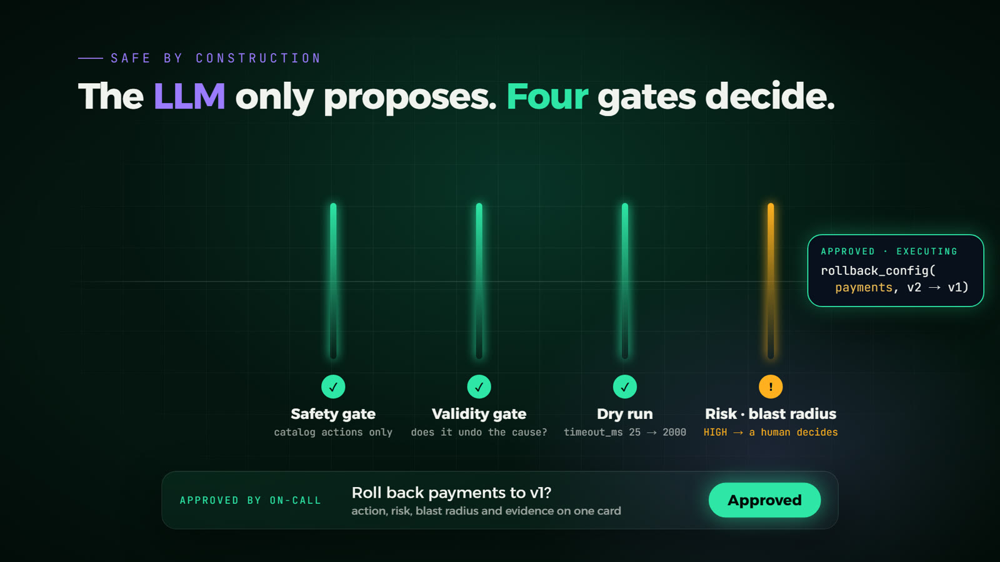

# How Nabd decides

[Back to the README](../README.md)

## Two engines and a router

| | Core engine (local) | LLM deep path |
|---|---|---|
| When | one known signature at ≥ 80% confidence | several concurrent root causes, low confidence, or alerts no signature explains |
| How | evidence, then failure signatures, then a rule-based skeptic | a tool-use loop over the same read-only tools, a structured `submit_diagnosis`, and a separate skeptic review |
| Cost | 0 tokens, about 2 s | a few cents per incident (Claude Opus 5.5, prompt caching, effort `medium`) |

Incident memory matches a new incident's fingerprint against past ones and reuses the fix that worked, for zero tokens.

Logs never reach the model raw. Drain3 turns thousands of lines into a dozen templates with counts, and the War Room shows how much reading that saved.

The API call uses adaptive thinking with summarized display, so the War Room can stream the model's reasoning live. It also uses strict tool schemas and server-side refusal fallbacks (`fallbacks: "default"`). Any API problem drops back to the core engine, so an incident never stalls on the model.

## Four checks before any action

<p align="center"></p>

The model only proposes. Every proposed action passes four checks before anything runs:

1. Safety gate. Only catalog actions run, with validated parameters: no shell, no Postgres restarts, no deleting live reservation keys, and no "restarting" an external provider.
2. Validity gate. Does this action undo the diagnosed cause, on the diagnosed component? A restart cannot fix a bad config deploy, because the service re-reads the same bad value, and it cannot release a lock held by another session. When the diagnosis implies exactly one valid fix, the gate corrects the proposal; otherwise it blocks it.
3. Dry run. Can the action run right now, and what exactly would it change? For example: "v2 → config of v1: timeout_ms 25 → 2000", "93 keys would be deleted", or "the standby link answers in 9 ms". Nabd also never rolls back its own rollback.
4. Risk and blast radius. The dependency graph sizes the blast radius, and the risk level decides whether a person must approve. For reversible actions, a guard reverts the change automatically if errors rise afterwards.

The validity gate exists because of R2Act ([arXiv 2607.04623](https://arxiv.org/abs/2607.04623)). It evaluated 302 Kubernetes incidents: the strongest RAG-based LLMs identified the faulty service 91.4% to 99.7% of the time, yet chose a valid recovery action only 36.8% to 60.3% of the time.

The action catalog has 11 entries: restart or start a service, flush Redis keys under a prefix, roll back a config, switch the database route, terminate database sessions, and the five Mizan repairs (rebuild paid orders, refund failed payments, replay lost events, quarantine a stuck message, restore catalog prices).

## Fault catalog

| Fault | What really happens | Correct fix |
|---|---|---|
| Cache key leak fills Redis | a session-dump job writes keys with no TTL until Redis passes `maxmemory` (noeviction) | delete keys under `tmp:session-dump:` |
| Bad config deploy | ci-bot ships payments v2: PSP timeout 2000 → 25 ms | roll back the config (needs approval) |
| Degraded DB link | Toxiproxy adds about 700 ms to the orders → Postgres primary link | fail orders over to the standby link |
| Auth crash | the auth container is killed | start it |
| Runaway reindex | a background job holds the CPU and the GIL in inventory | restart inventory |
| Memory leak | payments grows about 3 MB/s toward its 320 MB limit | restart before the OOM kill (predictive) |
| Connection hoarding | `nightly-report-job` takes every free Postgres slot | terminate that client's sessions |
| Lock contention | `analytics-migration` holds ACCESS EXCLUSIVE on products | terminate the blocker |

There are also 7 multi-fault scenarios, Perfect storm among them (two faults in one service, a crash plus a lock, and more), and a button that injects 1 to 3 hidden faults.

### Silent faults

No service errors and no Prometheus alert fires for any of these. Only Mizan sees them.

| Silent fault | What really happens | Correct outcome |
|---|---|---|
| Paid orders silently vanish | ci-bot ships `write_mode: batched` for orders. Checkout still says success, but each flush keeps only the first 8 buffered orders and drops the rest | roll back orders, then rebuild every promised order from the PSP ledger |
| Queue loses orders in a flash sale | ops caps the order-event queue at 50 (8 minutes earlier, harmless). A flash sale brings 30 shoppers, and the oldest events are trimmed before fulfillment sees them | roll back orders, then re-publish the lost events |
| Fulfillment hangs on one order | a pallet order needs a freight quote; the carrier never answers and the call has no timeout. The worker stays up, healthy and silent | quarantine the message, let the line drain, and hand the order and the carrier to a person |
| Sync job slowly corrupts prices | ci-bot ships catalog-sync `reprice_mode: fx_roundtrip` at `fx_rate` 3.70 against the 3.75 peg. Each run rewrites every price from its own last output, about 1.3% lower every time | roll back catalog-sync, restore the prices from the supplier, and hand the under-priced sales to a person |
| Stock silently stops going down | inventory deploys `reserve_mode: deferred`, which takes stock decrements off the checkout path | roll back inventory and hand the stock recount to a person |

### Held-out faults

The faults above were written together with the core engine's signatures, so scoring well on them proves less than it seems. These four were added afterwards, and no signature exists for any of them. They measure what Nabd does with something it has never seen.

| Held-out fault | What really happens | Correct outcome |
|---|---|---|
| Session lifetime set to zero | sec-bot deploys auth `token_ttl_s` 3600 → 0; every checkout gets 401 | roll back the auth config |
| Cache host typo | inventory is pointed at `redis-cache.internal`, which does not resolve | roll back the inventory config |
| Payment provider outage | the external PSP declines every charge with 503 | touch nothing and escalate, because nothing inside Dukkan can fix it |
| Redis process dies | the Redis container is killed | start Redis |

With an API key, the router sends these to the LLM path. Without one, the right behaviour is to change nothing and page a person with the evidence, instead of guessing.

## Use an LLM

Copy `.env.example` to `.env` and set a key, then run `docker compose up -d nabd`.

| Provider | `.env` |
|---|---|
| Claude (default) | `NABD_LLM_API_KEY=sk-ant-…` |
| DeepSeek, or any Anthropic-compatible API | `NABD_LLM_API_KEY=…` plus `NABD_LLM_BASE_URL=https://api.deepseek.com/anthropic` and `NABD_MODEL=deepseek-v4-pro` |

Nabd reads its own `NABD_LLM_*` names on purpose. A shell that already exports `ANTHROPIC_BASE_URL` for another tool would otherwise send a non-Anthropic key to the wrong place. In the War Room, ⚙ switches the engine between Auto (the router decides) and Core.

## Code layout

```
nabd/app/
  agent.py         the incident loop and approvals
  core_engine.py   evidence gathering, failure signatures, rule-based skeptic
  claude_engine.py LLM tool-use investigation and skeptic review
  tools.py         read-only investigation tools (shared by both engines)
  actions.py       remediation catalog and safety gate
  mizan.py         business invariants, item tracing and the deterministic repairs
  learned.py       laws learned from healthy traffic, ACI thresholds, lag vs loss, localization
  verify.py        synthetic journeys, SLO checks and the books
  schema.py        idempotent migration for databases created before Mizan
  telemetry.py     Prometheus, Redis, Postgres, Docker and the health model
  logs.py          Drain3 log compression
  memory.py        incident memory
  postmortem.py    bilingual postmortems
  chaos.py         fault injection with ground truth (the engines never read it)
  benchmark.py     scored benchmark against the runbook baseline
nabd/ui/           the War Room (plain HTML and JavaScript, no build step)
```
