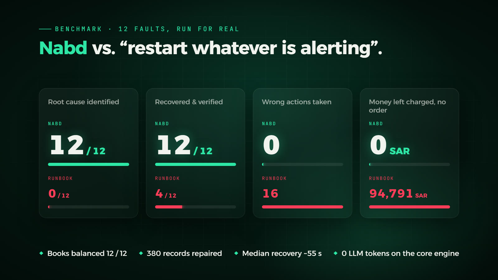

# Evaluation

[Back to the README](../README.md)

Every number here comes from a logged run in [`eval/results`](../eval/results). The store is a test store with simulated shoppers, so every SAR amount below is test money.

- [Benchmark against a restart runbook](#benchmark-against-a-restart-runbook)
- [Ablation: which part catches what](#ablation-which-part-catches-what)
- [Before Mizan](#before-mizan)
- [Blind faults](#blind-faults)
- [External benchmark: Cloud-OpsBench](#external-benchmark-cloud-opsbench)
- [External benchmark: RCAEval](#external-benchmark-rcaeval)
- [Reproduce every number](#reproduce-every-number)

## Benchmark against a restart runbook

<p align="center"></p>

The Benchmark tab in the War Room runs every fault and scenario for real. It injects the fault, lets Nabd handle it end to end, and resets. Each run is scored against the ground truth: detection time, root-cause accuracy, recovery, MTTR, wrong actions and LLM cost, plus whether the books balanced when the incident closed and how much money was left charged without an order. The baseline is the classic runbook: restart whatever is alerting. Results are saved in the `nabd-data` volume.

### With Mizan, before the learned laws

24 runs: the 8 known single faults and the 4 silent faults, once each, for Nabd's core engine (0 LLM calls) and for the runbook. This run came before the learned laws were added; the [ablation](#ablation-which-part-catches-what) and the final check below ran on the current version. Mizan's repairs (rebuilding orders, refunding charges, replaying events, restoring prices) are scored as repairs, not as actions. Their dry run refuses to touch anything the books do not prove broken.

| | Nabd | Restart runbook |
|---|---|---|
| Root cause identified | 12 / 12 | 0 / 12 |
| Recovered and verified | 12 / 12 | 4 / 12 (one of them temporary, see below) |
| Wrong actions taken | 0 | 16 |
| Books balanced when the incident closed | 12 / 12 | 6 / 12 |
| Money left charged with no order | 0 SAR | 94,791 SAR |
| Records repaired | 380 | 0 |
| Median time to detect, known / silent | 13 s / 23 s | 14 s / 22 s |
| Median time to recover, known / silent | 55 s / 53 s | n/a |

The silent faults, run by run:

| Silent fault | Nabd | Runbook |
|---|---|---|
| Paid orders silently vanish | rolled back orders, rebuilt 54 orders (14,193 SAR) · 63 s | restarted orders; the batch setting kept eating orders · 16,798 SAR left |
| Queue loses orders in a flash sale | rolled back the cap, re-published 215 lost events · 43 s | nothing to restart, escalated · the 215 orders never ship |
| Fulfillment hangs on one order | quarantined the pallet order, handed it and the carrier over · 106 s | restarted fulfillment and "recovered", but the restart only moves the poison message to the back of the queue, where it blocks again when it reaches the front |
| Sync job slowly corrupts prices | rolled back catalog-sync, restored 7 prices, handed over the under-priced sales · 37 s | restarted inventory, which never writes prices · escalated |

The runbook's leftover money came from the payments timeout fault (61,476 SAR, customers charged although the checkout failed), the vanishing orders (16,798), connection exhaustion (11,862) and the degraded DB link (4,655). Nabd refunded the same kind of damage in its own runs: 95 charges (25,502 SAR) after the payments timeout and 9 (1,675 SAR) after connection exhaustion.

Not re-run on this version: the 7 multi-fault scenarios and the held-out faults. Their results below are from the version before Mizan. The workflow-hang detection time (88 s) included waiting behind a backlog left by the previous run; the benchmark now waits for the queue to drain first.

## Ablation: which part catches what

Does each part of Mizan earn its place? The ablation runs every silent fault, a benign flash sale and one loud fault (the payments timeout) against five versions: full Nabd, Nabd without the learned laws, without the hand-written books, without Mizan at all, and the restart runbook. That makes 35 runs on the live store from one command (`python eval/run_all.py --set ablation`). The full report is [ablation-20261030-1818.md](../eval/results/ablation-20261030-1818.md).

| | Full Nabd | No learned laws | No hand-written books | No Mizan | Restart runbook |
|---|---|---|---|---|---|
| Correct outcome (6 faults) | 6 / 6 | 5 / 6 | 4 / 6 | 1 / 6 | 1 / 6 |
| Detected | 6 / 6 | 5 / 6 | 6 / 6 | 1 / 6 | 6 / 6 |
| Books balanced at the end | 6 / 6 | 5 / 6 | 1 / 6 | 0 / 6 | 2 / 6 |
| SAR left charged with no order | 0 | 0 | 31,268 | 128,144 | 113,648 |
| Wrong actions | 0 | 0 | 0 | 0 | 7 |
| Benign flash sale | false alarm (1) | quiet | quiet | quiet | false alarm (2) |

| Fault | Full Nabd | No learned laws | No hand-written books | No Mizan | Restart runbook |
|---|---|---|---|---|---|
| Paid orders silently vanish | ✓ 52 s | ✓ 61 s | ✓ 58 s | missed | escalated |
| Queue loses orders in a flash sale | ✓ 43 s | ✓ 46 s | ✓ 59 s | missed | escalated |
| Fulfillment hangs on one order | ✓ 59 s | ✓ 54 s | escalated | missed | ✓ 56 s, but temporary |
| Sync job slowly corrupts prices | ✓ 58 s | ✓ 35 s | escalated | missed | escalated |
| Stock silently stops going down | ✓ 64 s | missed | ✓ 60 s | missed | escalated |
| Payments timeout (loud) | ✓ 62 s | ✓ 54 s | ✓ 55 s | ✓ 37 s | escalated |

What it shows:

- Without Mizan, every silent fault is missed. The classic alerts see nothing, and the loud fault is the only one handled.
- Without the learned laws, the stock fault is missed, because no hand-written book covers stock.
- Without the hand-written books, the learned laws still detect all six. Three are fixed by rolling back the change they point to. Two are escalated: the laws see a stalled consumer or a price flow, but cannot tell which message is stuck or what the right price is. Nothing rebuilds the lost orders, so 31,268 SAR stays charged with no order until a person acts.
- The runbook restarts whatever alerts. Its fulfillment "recovery" only moves the poison message to the back of the queue, and it leaves 113,648 SAR charged with no order.

(1) Full Nabd opened an incident during the flash sale. One learned law, learned within 1%, came up 7% short under five times the load. Nabd changed nothing and closed it as transient, but it was still a false alarm, so a law now breaks only when it is off by at least 10%. The re-run on the fixed version is below.
(2) The runbook's flash-sale run came right after a full restart of the stack (Docker had stopped mid-ablation). Under the load, the gateway failed some calls to the still-cold inventory service, and 26 of 1,493 checkouts failed. A classic alert fired, and the runbook restarted inventory and the gateway. This was a real, small degradation, not a learned-law alarm. The last five runbook runs ran on the version with the 10% floor. The runbook does not use the no-regression guard.

Re-run of full Nabd on the fixed version (10% floor and the corrected no-regression guard; [quick-20261030-1845.md](../eval/results/quick-20261030-1845.md)): all five silent faults were fixed with the books balanced, recovering in a median of 56 s with 0 wrong actions and 0 SAR left. No learned law fired during the flash sale in either re-run. In the first re-run the sale passed with no incident. In the second, the store itself ran slow under the load: the gateway's p95 latency reached 0.8 to 2.1 s against an 800 ms objective. The classic latency alert fired, and Nabd changed nothing and escalated. The scorer counts that as a false alarm, and we report it as one. The run before the guard was corrected is kept as [quick-20261030-1830-guard-bug.md](../eval/results/quick-20261030-1830-guard-bug.md).

The final check, after the rehearsal fixes ([quick-20261031-0339.md](../eval/results/quick-20261031-0339.md)), was clean: all five silent faults fixed with the books balanced, a median recovery of 55 s, 0 wrong actions, 0 SAR left, and the flash sale passed with no incident.

## Before Mizan

Results of the previous version: 38 runs, one per scenario per engine. The run started with an empty incident memory and used the core engine only, since no API key was set.

Known faults (8 single faults and 7 multi-fault scenarios):

| | Nabd | Restart runbook |
|---|---|---|
| Root cause identified | 15 / 15 | 0 / 15 |
| Recovered and verified | 15 / 15 | 3 / 15 |
| Wrong actions taken | 0 | 23 |
| Median time to detect | 12 s | 13 s |
| Median time to recover | 56 s | n/a: it recovered only the crash, the CPU hog and the leak |

Held-out faults (4 faults with no signature, core engine only):

| | Nabd | Restart runbook |
|---|---|---|
| Root cause identified | 0 / 4 | 0 / 4 |
| Correct outcome | 1 / 4 (the PSP outage, correctly left alone) | 0 / 4 |
| Wrong actions taken | 0 | 7 |
| What it did | escalated all four with the evidence and changed nothing, flagging the culprit deploy as the suspect in both config faults | restarted services that were not broken; the safety gate also refused its attempt to restart the external PSP |

On faults it knows, Nabd fixed everything. On faults it did not know, and without an LLM, it fixed nothing, but it also broke nothing and handed the person the right suspect.

Held-out faults with the LLM path (DeepSeek V4 Pro through its Anthropic-compatible API, empty memory):

| Held-out fault | Root cause | Outcome | Time to outcome | Wrong actions |
|---|---|---|---|---|
| Session lifetime set to zero | correct | recovered | 4 min 18 s | 0 |
| Cache host typo | correct | recovered | 3 min 31 s | 0 |
| Payment provider outage | correct | escalated, nothing changed (the right call) | about 6 min 30 s | 0 |
| Redis process dies | correct | recovered | 6 min 45 s | 0 |

That is 4 / 4 correct, against 0 / 4 for the core engine alone. The price is speed: 64 model calls across the four, and minutes instead of seconds. That is why the router uses the LLM only for what the signatures cannot explain.

An earlier DeepSeek run on the PSP outage got the first diagnosis right: "the external provider is down; nothing to fix here". Nabd then retried because the store was still unhealthy, and under that pressure the model started guessing. First it proposed restarting the external provider, and the safety gate refused. Then it proposed rolling back an innocent payments config; the skeptic refuted it and the dry run blocked it. Nothing wrong was executed, but the incident took 14 minutes. Two rules came out of it:

1. A confident "outside our control" diagnosis now escalates immediately, instead of retrying and inviting guesses.
2. Nothing the skeptic refuted is ever executed.

The same run showed that DeepSeek sometimes submits malformed diagnoses, because strict tool schemas are guaranteed only on Anthropic's API. Nabd now validates every submission in code and sends malformed ones back to be fixed. This matches R2Act's finding: a model that names the right cause can still propose the wrong fix, and the checks around the model are what make it safe to let it act.

Three known scenarios took a second round: memory leak plus bad config in the same service, lock plus leak, and crash plus lock. In each, one fault's signal surfaced only after the first fix. The verifier caught it and Nabd went back for it.

## Blind faults

Every fault in the catalog was written by the people who wrote Nabd, so scoring well on them proves less than it seems. A blind fault is written by someone else, in `eval/blind/faults.json`, which the authors never open before the run. It is built from generic steps: SQL, a config deploy, a Redis command, a network toxic, killing a container, or changing the load. Nabd runs it blind and is scored against the truth its writer gave.

There is no second team on this project, so a different model wrote them. DeepSeek V4 Pro got only what a new teammate gets: the README, the [blind-fault guide](../eval/blind/README.md), the database schema and a sheet of public facts. It was asked for silent faults, loud faults, faults that need a person, and faults that look like one component but are another, none of them already in the catalog. Each fault had to pass a safety check before it was kept: no dropped tables, no calls to Nabd, nothing outside the store. Two of the seven it wrote were rejected. The generator prints only counts and the file's SHA-256 (`82a0e4b1…`, in [provenance.json](../eval/blind/provenance.json)), so the file could be published unchanged after the run and checked against the hash. To write your own, follow the guide.

Results (10 runs, [blind-20261030-1939.md](../eval/results/blind-20261030-1939.md)). Scored strictly against the truth the model wrote, Nabd handled 2 of 5 and the runbook 0 of 5. We opened the file only after the runs. Its hash still matched, and the faults are now published as [faults.json](../eval/blind/faults.json). Reading them showed that the descriptions and the steps do not always agree:

| Blind fault, as its writer described it | What its steps actually did | Nabd | Runbook |
|---|---|---|---|
| 1 · A trigger silently discards every new order (expect: escalate) | exactly that | detected in 23 s, blamed orders, escalated, which is the right answer, because no safe action removes a code-level trigger | restarted inventory, escalated |
| 2 · A trigger rewrites every new order's total to 1.00 SAR (escalate) | exactly that | missed: every payment still had its order, and the books checked that orders exist, not their amounts | restarted orders, escalated |
| 3 · A queue message is duplicated and gets stuck (recover) | pushed one made-up event onto the queue; fulfillment shipped it, and nothing got stuck | missed: a shipment with no order behind it was invisible | missed |
| 4 · The supplier is blocked by a firewall (escalate) | added a 30 s timeout on the orders → Postgres link, not the supplier | moved orders to the standby link and refunded 54 charges (14,321 SAR); recovered in 73 s. Scored wrong, because the label says supplier | restarted orders and the gateway, escalated, 26,561 SAR left |
| 5 · catalog-sync writes prices to the wrong table (recover) | changed a config key that catalog-sync never reads, so it had no effect | a latency blip opened an incident; Nabd changed nothing and it cleared in 183 s. Scored correct, with the wrong root cause | missed |

Only faults 1 to 4 broke anything, and fault 4 broke something other than what its label claims. Of those four, Nabd handled 1 and 4 and missed 2 and 3; the runbook handled none. Both misses were real gaps in the books. The money book matched charges to orders by ID and never compared the amounts. The fulfillment book checked that every order ships, but not that every shipment has an order.

After reading them, we closed both gaps, so these two faults are no longer blind. The money book now reconciles amounts as well as existence: an order whose total differs from what the provider captured breaks it, which is the core of ledger reconciliation as payment companies describe it (Stripe's engineering write-up on its Ledger, 2024). The fulfillment book now runs in both directions: every shipment needs an order. Neither has a safe automatic repair, so both stop Nabd and hand the list to a person. A unit test pins each one.

### Blind retest

This run only checks that the gaps are closed and that nothing else moved ([retest-20261030-2000.md](../eval/results/retest-20261030-2000.md), [retest-blind3-20261030-2004.md](../eval/results/retest-blind3-20261030-2004.md)).

| | Before | After |
|---|---|---|
| 2 · order totals rewritten to 1.00 SAR | missed | detected in 30 s, blamed orders, escalated with the list of wrong orders; scored correct |
| 3 · a made-up event shipped with no order | missed | detected in 9 s, "1 shipment was booked for an order that does not exist", escalated; the writer's label says *poison message, recover*, so it still scores wrong |
| the five silent faults | 5 / 5 | 5 / 5, books balanced, 0 SAR left |
| the flash sale | quiet | quiet |

The first attempt at fault 3 still missed, for a reason in the test bench: the blind run had already shipped that made-up order, and the fault's undo empties the queue but leaves the shipment, so the retest's copy was ignored as a duplicate and no new shipment appeared. With the leftover row removed, it was caught in 9 s.

## External benchmark: Cloud-OpsBench

To test Nabd's method on incidents nobody on the team wrote, we used Cloud-OpsBench ([arXiv 2603.00468](https://arxiv.org/abs/2603.00468)), which has 754 recorded Kubernetes incidents and runs offline. The comparison: 40 pre-registered cases, DeepSeek Flash, and the benchmark's own ReAct agent against the same agent with Nabd's diagnosis checks (validity gate and skeptic). The reference agent ran twice, to measure noise.

| | Reference (2 runs) | With Nabd's checks |
|---|---|---|
| Root cause correct | 97.5% / 92.5% | 92.5% |
| Evidence closure | 57.5% / 67.5% | 75.0% |
| Output tokens per case | 3.0k / 3.4k | 12.1k |

The diagnosis checks made no measurable difference. The evidence gain sits within run-to-run noise, and they cost about four times the output tokens. A modern model already diagnoses these cases at 93 to 97%, so the hard part is choosing and verifying the fix, as R2Act found, and Cloud-OpsBench does not measure that part. The full method, statistics and a disclosed bug from the first run are in [eval/README.md](../eval/README.md).

## External benchmark: RCAEval

Do the learned laws work on a system we did not build? [RCAEval](https://arxiv.org/abs/2412.17015) (WWW 2025) publishes recorded fault injections on two open-source shops: Online Boutique (RE1-OB) and Sock Shop (RE1-SS). Each has 125 cases: 5 services × 5 faults (CPU, memory, disk, delay, packet loss) × 5 runs. We ran the learned-laws method offline on every case. It learns the pairs of metrics that move together in the healthy part, then ranks services by the share of their laws that broke after the injection; a metric with no law falls back to how far it left its own range. The parameters are Nabd's own: correlation of at least 0.6, three windows in a row, and the same 1.25 slack. RE1-OB was the development set. RE1-SS was run once, afterwards, as the held-out set. BARO ([FSE 2024](https://github.com/phamquiluan/baro)), the reference method in RCAEval, ran on exactly the same inputs from its authors' package.

| The real cause ranked… | RE1-OB · learned laws | RE1-OB · BARO | RE1-SS · learned laws | RE1-SS · BARO |
|---|---|---|---|---|
| first (AC@1) | 0.50 | 0.72 | 0.67 | 0.84 |
| in the top 3 (AC@3) | 0.84 | 0.91 | 0.92 | 0.98 |
| Avg@5 | 0.78 | 0.88 | 0.87 | 0.96 |

For detection, one model learned on the first half of the healthy period judges the second half and the same length of time after the injection. The share of broken laws separates the two with an AUROC of 0.82 on RE1-OB and 0.96 on RE1-SS, with nothing tuned.

On these faults BARO localizes better than the learned laws. They are loud resource faults: the culprit's own CPU, memory or latency jumps, so a scorer that looks at one metric at a time sees it directly. Resource metrics also drift over the 6 to 35 healthy minutes these cases have, so many laws are fragile; on healthy RE1-OB data a median of 34% of them broke. The laws are built for the opposite kind of fault, where each metric alone can move a lot for an innocent reason and only the ratio between two of them separates load from loss. In a flash sale every flow in Dukkan rises five times; a one-metric scorer would flag the sale itself, while no learned law broke. So Nabd uses the two for different jobs: loud faults go through the alerts and the rules, silent ones through Mizan. The code and per-case results are in [run_rcaeval.py](../eval/rcaeval/run_rcaeval.py) and `eval/results/rcaeval-*`.

## Reproduce every number

```bash
python eval/run_all.py --set ablation
```

This runs the ablation: every silent fault plus a benign flash sale, against full Nabd, three variants with parts of Mizan switched off, and the restart runbook. It takes about two hours. `--set quick` runs full Nabd only, `--set blind` runs the blind faults, `--set retest` re-runs the two blind faults that exposed gaps plus the quick set, and `--set full` runs everything. Each run writes `eval/results/<set>-<time>.json` and a markdown report. If the script is interrupted, `--attach` waits for the benchmark that is still running inside Nabd and writes the report.

The RCAEval comparison takes about 30 s, after you download RE1-OB and RE1-SS from [Zenodo](https://zenodo.org/records/14590730) into `eval/rcaeval/data/` and run `pip install fse-baro pandas`:

```bash
python eval/rcaeval/run_rcaeval.py
```

New blind faults from a different model (prints counts and a hash, never the faults):

```bash
python eval/blind/generate_blind.py --n 6
```

The 21 unit tests need no running store. They cover the learned laws, the no-regression guard, the gates and the rules:

```bash
docker compose run --rm --no-deps nabd python -m unittest discover -s /srv/tests -p "test_*.py" -v
```
