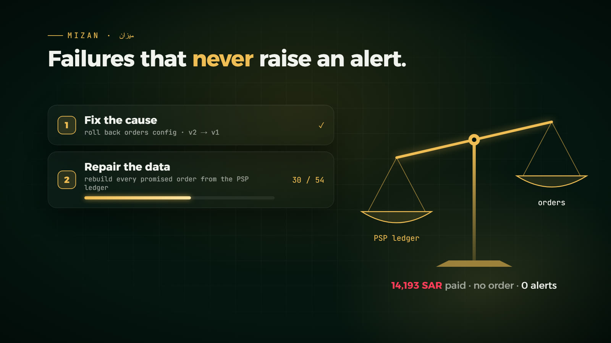
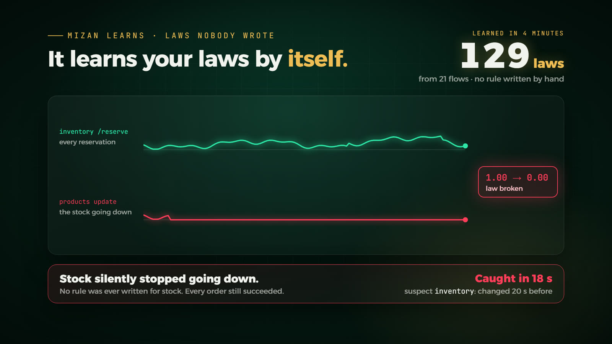

# Mizan: failures that never raise an alert

[Back to the README](../README.md)

The hardest failures are the quiet ones. Every request returns 200, no error is logged, latency is flat, and money or orders still disappear. A health check cannot see them, because each service is healthy on its own. What breaks is the agreement between records.

Mizan (ميزان, "balance") checks that agreement every 3 seconds, using records that live outside the services that could be wrong about it:

| Invariant | Checked against | Catches |
|---|---|---|
| Every captured payment has an order, for the same amount | the PSP's own settlement ledger and the orders table | orders dropped after the customer paid; charges left behind by failed checkouts; orders that record a different total than was charged |
| Every order reaches fulfillment, and every shipment has an order | orders, fulfillments, and everything still in the queue | orders whose events vanished; shipments booked for an order nobody placed |
| Every order event is accounted for | produced = consumed + waiting + in flight + dead-lettered (one atomic read) | a queue that drops messages |
| Fulfillment keeps moving | worker heartbeat and the message it holds | a workflow stuck forever on one message |
| Every price matches the supplier | the supplier's catalog and the products table; a database trigger records which client wrote each price | a sync job that slowly corrupts data |

A violation must hold on two checks in a row before it alerts, and a charge must be 20 seconds old before it counts. Then Nabd does three things that classic recovery skips.

1. It traces the lost item. `trace_item` follows one payment or order through every hop and every durable record, and reports the last component that held it: *"charged, told the customer ord-338b exists, the orders service logged 'queued for batch insert', and there is no order row."* The loss sits inside orders, so the recent change that configures orders is the suspect. The skeptic then checks the timing: did the loss start after that change?
2. It fixes the cause first, then repairs the data. A rollback stops new damage, but the damage already done remains. The repairs are fixed accounting code; no model writes them.
   - Honor what the customer was told. If the gateway said "checkout completed", the order is rebuilt from the PSP's charge metadata under the order number the customer already has.
   - Refund what the customer never got. If the customer saw an error but was charged anyway, the charge is refunded at the PSP.
   - Re-publish lost events. Fulfillment books each order at most once, so this is safe to repeat.
   - Quarantine a poison message. It moves to the dead-letter queue, the line behind it moves again, and a person gets that one message.
   - Restore corrupted values from the source of truth. Sales already made at a wrong price go to a person, because re-billing a customer is a business decision.
3. It proves the books balance before it calls the incident resolved.

Mizan also changed what the old faults revealed. The classic *bad config on payments* fault used to end with "rollback, recovered in 58 s". With Mizan watching, the same incident showed what that recovery left behind: the PSP had kept capturing charges the payments service had already abandoned. 109 customers had been charged 28,400 SAR for orders they were told had failed. Nabd refunded them after a person approved the amount.

## The learned laws

The five books above were written by hand for this store, and another system would need its own. So Mizan also learns the store's laws by itself from four minutes of healthy traffic. It knows nothing about what the store does. It only counts what any system exposes:

- successful requests per service and route (Prometheus);
- inserts and updates per table (Postgres statistics);
- write commands per type (Redis reports which commands write).

It keeps every pair of flows that moved in a fixed ratio and rose and fell together. In our runs that gave 129 laws over 21 flows; the exact count depends on the traffic it sees while learning. Some examples:

- 1.00 update on table products for every successful inventory /reserve;
- 1.00 Redis LPUSH for every insert into orders;
- 3.00 Redis SET for every checkout.

A ratio stays the same under load, so a flash sale should leave it alone. A silent failure breaks it, because one side keeps counting while the other stops.

| Step | How | Source |
|---|---|---|
| Learn | least-squares ratio per pair of flows; a law must hold within 7% on 95% of training windows, and the two flows must correlate (≥ 0.6), so a poller that happens to look as steady as the traffic does not become a law | flow-intensity invariants, [Jiang, Chen & Yoshihira, ICAC 2006](https://search.isc.ac/inventory/49/2341853.htm) |
| Judge | every 5 s over 30 s windows; a law breaks only after three misses in a row and when it is off by at least 10% | |
| Adapt | each law's threshold moves with Adaptive Conformal Inference: an isolated miss raises the bar for that law, a quiet stretch lowers it, with a long-run false-alarm target of 1% | [Gibbs & Candès, NeurIPS 2021](https://proceedings.neurips.cc/paper/2021/hash/0d441de75945e5acbc865406fc9a2559-Abstract.html) |
| Lag or loss | a Redis list that fills or drains by a matching amount means the items are waiting, not gone; a consumer that counts nothing while its list grows is a stall | |
| Localize | suspects are the services on the healthy side of the broken laws, ranked by the share of their laws that broke, a config change shortly before the break, and log lines they never printed while healthy | change attribution: [Gandalf, NSDI 2020](https://www.usenix.org/conference/nsdi20/presentation/li); log invariants: [Lou et al., ATC 2010](https://www.usenix.org/event/atc10/tech/full_papers/Lou.pdf) |

Each part of Mizan can be switched off on its own (⚙ in the War Room). That is how the [ablation](evaluation.md#ablation-which-part-catches-what) is run.

With the hand-written books switched off, the learned laws alone did the following (single runs):

| Fault | Learned laws only |
|---|---|
| Stock silently stops going down (no hand-written rule covers stock) | detected in 18 s; suspect inventory: the change 20 s before and 27× "deferred stock decrement …", a line inventory never logged while healthy; rolled back, recovered in 65 s, stock recount handed to a person |
| Paid orders silently vanish | detected in 22 s (the hand-written books took 32 s); suspect orders, with 138× "queued order … for batch insert"; recovered in 68 s |
| Queue loses orders in a flash sale | detected in 35 s; suspect orders, changed 8.6 min earlier; recovered in 73 s |
| Fulfillment hangs on one order | recognized as a stall ("work keeps arriving but its consumer has stopped"); changed nothing and escalated, because laws alone cannot tell which message is stuck |
| Flash sale, five times the shoppers, nothing broken | 0 broken laws, 0 incidents; the consumer side read as lagging |

The learned laws know that items were lost, but not how to rebuild them. Rebuilding an order or refunding a charge needs the money rules of the hand-written books, so in learned-only mode the lost work goes to a person.

### How testing changed the design

Running faults found seven problems that reading the code had missed. Each now has a regression test.

- The window was measured from the oldest snapshot in memory instead of the last 30 s. Breaks showed as 12% instead of 100% and outlived the fix by minutes.
- Steady traffic made a 5-second poller look like a law. The fix requires the two flows to correlate.
- A backlog draining after a flash sale broke 68 laws. Lag now counts in both directions.
- A busy queue could excuse an unrelated loss. The queue now only excuses a deficit of matching size.
- In the ablation, full Nabd opened an incident during the benign flash sale: one law learned within 1% came up 7% short under five times the load. Nothing was changed and the incident closed as transient, but it was still a false alarm. A law now breaks only when it is off by at least 10%, however tightly it was learned.
- The first version of the no-regression guard reverted a correct fix. Nabd rolled back catalog-sync, which was right. Seconds later a law failed because its 30-second window still held the fault, and the guard undid the rollback, which put the fault back. A law is now held against a fix only when its whole window comes after Nabd's last change and it counts the changed service's own requests.
- In the demo rehearsal, a repair rebuilt 421 orders at once. That burst broke 71 laws, and a second incident opened right after the first was resolved. The laws now stay quiet for one minute after Nabd's own repairs, until the burst has left the window.

## The escalation contract

The challenge brief warns about a repair agent that never escalates. Nabd's limits are written in code and shown in the War Room:

| Nabd hands over to a person when | Example |
|---|---|
| the cause is outside its control | the payment provider is down: escalate immediately and change nothing |
| two rounds pass without a safe fix | an unknown failure with no LLM: escalate with the evidence and the suspect |
| the autonomy budget is spent: 6 actions or 15 minutes per incident | stop acting and hand over everything found so far |
| an action would move more than 10,000 SAR | recreating 12,171 SAR of orders or refunding 28,400 SAR always waits for approval, even in Autopilot |
| it can diagnose the cause but must not fix it | the freight carrier's API hangs: Nabd unblocks the queue, then hands over the parked pallet order and the carrier with a concrete request |
| the remaining fix is a business decision | prices are restored, and the orders already sold below price are handed over: honor them or contact the customers |
| its own fix made things worse | the no-regression guard below undoes the fix when it can, and Nabd stops acting either way |

Every handover appears in the postmortem under *Handed to humans*.

### The no-regression guard

A fix must not break anything that worked before it. Just before each fix, Nabd notes which learned laws hold. A law counts as a regression when it held before the fix, it counts the changed service's own requests, and it fails on a window measured entirely after Nabd's last change. A law is judged over the last 30 seconds, so for 30 seconds after any change the window still holds the fault itself, and nothing that fails then is held against the fix.

When the guard finds a regression, it undoes a rollback or a database-route switch automatically, and hands a fix that cannot be undone to a person with the broken law named. Either way, Nabd stops acting on that incident. The idea comes from the transactional no-regression of [STRATUS (NeurIPS 2025)](https://arxiv.org/abs/2506.02009), measured here with the store's own learned laws instead of a hand-written health score. It runs alongside an older guard that undoes a fix when the gateway's error rate jumps.

## What this covers from the challenge brief

| The brief | In Nabd |
|---|---|
| Payments that silently drop orders | `silent_order_drop`: the money invariant, a trace to orders, a rollback, then rebuilding the orders from the PSP ledger. The same invariant catches charges left behind by loud failures. |
| A queue that loses messages under load | `queue_drop_under_load`: a queue cap that is harmless until a flash sale. Conservation finds the unaccounted events; then a rollback and a replay. |
| A workflow that hangs forever | `workflow_hang`: the progress invariant spots a worker silent on one pallet order, quarantines that message and hands it over. |
| A repair agent that never escalates | the escalation contract above, with the budget meter in the War Room |
| A sync job that slowly corrupts data | `catalog_price_drift`: catalog-sync starts pricing through an FX round trip at a slightly wrong rate, and every price loses about 1.3% per run, compounding. The price invariant catches the first run. The database trigger names the writer, so Nabd rolls back, restores the prices, and hands the under-priced sales to a person. |
